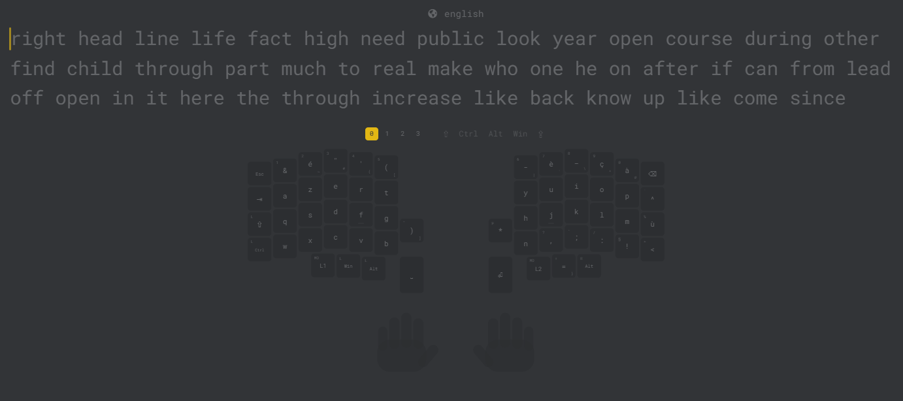

# AZERTY Layout for GordonMohrin's *Split Keyboard for monkeytype* extension

> **This is a fork** of [GordonMohrin/split-keyboard-for-monkeytype](https://github.com/GordonMohrin/split-keyboard-for-monkeytype)
> that adds a **French (AZERTY)** system layout.
>
> **I do not own any of this content.** The extension, its code, design and documentation were all created by
> [GordonMohrin](https://github.com/GordonMohrin), and all credit goes to them. My only contribution is the
> French AZERTY layout. If you like the extension, please star the [original repository](https://github.com/GordonMohrin/split-keyboard-for-monkeytype).
> The code stays under GPL-3.0-or-later, see [LICENSE](LICENSE).

## What this fork adds

- **French (AZERTY) layout** (Windows/Linux fr-FR) in ⌨ Split → System layout, and in the standalone trainer's settings.
  - Letters follow AZERTY: KC_Q shows "A", KC_W "Z", KC_A "Q", KC_M ",", and the `;` key "M".
  - Digits need Shift (the number row types `& é " ' ( - è _ ç à`), and the next-key hint shows the Shift key.
  - AltGr layer: `~ # { [ | \ ^ @ ] } €` (Ctrl+Alt counts as AltGr on Windows).
  - Detected automatically when your OS layout is French AZERTY; you can also pick it by hand.

## Install

1. Download `split-keyboard-for-monkeytype-<version>.zip` from **this fork's**
   [latest release](../../releases/latest) and unzip it into a folder that stays put.
2. Open `chrome://extensions` and switch on **Developer mode**.
3. Click **Load unpacked** and pick the unzipped folder.
4. Open monkeytype.com, click **⌨ Split** → **Connect keyboard**, then set **System layout** to
   *French (AZERTY)*.

For everything else (unlocking, VIA keyboards, privacy, limits), see the
[original README](https://github.com/GordonMohrin/split-keyboard-for-monkeytype#readme).

## License

GPL-3.0-or-later, see [LICENSE](LICENSE). The keyboard's look and behavior follow monkeytype's keymap
([monkeytypegame/monkeytype](https://github.com/monkeytypegame/monkeytype), GPL-3.0): `sub-alt` keys and `sub`
legends, next key in the main color, 250 ms hit/miss flash, homing bars on the index keys.
The Halcyon Kyria files in `tools/fixtures/` come from [splitkb/qmk_userspace](https://github.com/splitkb/qmk_userspace)
(branch `halcyon`, GPL-2.0-or-later).